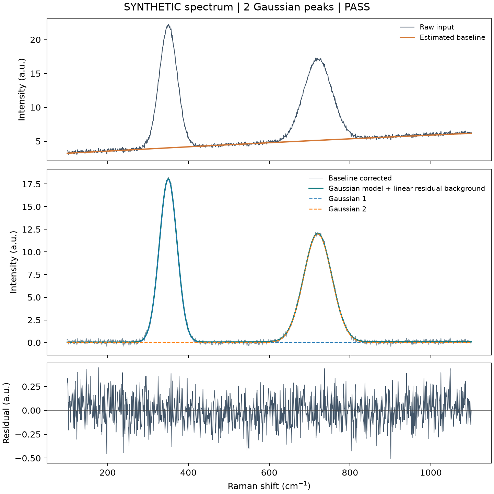

# Raman Spectroscopy Analysis

Reproducible scientific Python analysis of tabular Raman spectra. This project
continues an owner-authored high-pressure Raman analysis program, **SHproject**,
while separating its experiment-specific settings from a configurable public API.
It is independent of the φ³ theoretical-physics project.

**Implemented:** explicit CSV/TSV/TXT/XLSX column imports, missing-value policy,
unit and duplicate-axis validation, AsLS or reference-region polynomial baseline
estimation, bounded one-to-eight Gaussian fits with linear residual background,
local parameter covariance, FWHM/area uncertainties, residuals and numerical/figure
exports. Pressure metadata is optional; no pressure table or sample identity is
required to analyze an individual spectrum.

**Verified demonstration:** a seeded, explicitly synthetic two-peak spectrum.
The example is a software validation case, not an experimental observation or a
physical identification. It does not establish performance on all Raman materials.



## Scientific background and legacy source

The original program was developed for pressure-dependent Raman and photoactivity
comparisons. Its source contains fixed pressure lists, named experiment profiles,
measurement-window choices and pressure-conditional plotting rules. Those are
specific analysis decisions rather than universal properties of Raman spectra.

[Preserved SHproject source](legacy/SHproject) retains the processing modules and
command-line scripts. Historical experimental profiles are replaced by public
templates. Raw measurements, old figures, run logs and duplicate archives are
excluded pending separate data-publication review. [The source audit](docs/legacy-audit.md)
records concrete restrictions and which ones the new API addresses.

No claim is made that the experimental material was synthesized during compression,
or that any fitted band proves a phase transition or chemical identity.

## Installation and quick start

Requires Python 3.11 or newer.

```bash
python -m venv .venv
# Activate the environment using your platform's normal command.
python -m pip install ".[dev]"
raman-analyze demo --output runs/demo
```

The demo writes `synthetic.csv`, the random seed and ground truth, `config.json`,
and an `analysis/` directory containing raw/corrected spectral columns, fitted
curves, Gaussian components, residuals, peak parameters, a JSON report, PNG/PDF
figures and artifact hashes. Use a new output directory for each run.

## Analyze your own spectrum

Create a header-based CSV with `shift_cm1` and `intensity` columns, or specify
column names/zero-based indices explicitly. Relative paths resolve against the
configuration file's directory, not the shell's working directory.

```json
{
  "data_kind": "measurement",
  "input": {
    "path": "spectrum.csv",
    "x": "shift_cm1",
    "y": "intensity",
    "units": "cm^-1",
    "missing": "error"
  },
  "baseline": {"method": "asls", "lam": 1000000, "p": 0.01, "iterations": 30},
  "fit": {
    "window": [100, 1100],
    "peaks": [{"center": 350, "sigma": 20}, {"center": 720, "sigma": 30}]
  }
}
```

```bash
raman-analyze run config.json --output runs/measurement-01
```

For XLSX, set `path` to the workbook and optionally `sheet` in `input`.
TXT is delimited text with a header; set `delimiter` explicitly if needed.
A `sigma` column supplies positive measurement standard deviations for absolute
weighted covariance. Unknown/missing data are not silently filled. Duplicate axis
values require a preprocessing decision outside this API; a descending axis is
sorted and recorded. The input file is never rewritten.

## Methodology and uncertainty

The baseline is estimated separately and exported. AsLS assumes positive peaks
and approximately uniform sampling because its curvature penalty acts on sample
indices. Irregular sampling requires a different baseline method or an explicit,
separately documented resampling step. Polynomial baselines require user-chosen
reference `regions`; `none` performs no baseline subtraction.

Fits minimize squared residuals with Gaussian peaks and a linear residual
background. Peak counts, seeds and optional `center_bounds`/`sigma_bounds` are
explicit. Nonconvergence yields `FAIL`, while rank deficiency, poor conditioning
active bounds, strongly correlated residuals or excessive residual/noise mismatch yield `INCONCLUSIVE`. Neither falls back to an unlabelled maximum.

Local covariance uses the fit Jacobian, scaled by residual variance when absolute
measurement errors are absent. The area error includes amplitude/width covariance;
FWHM is `2 sqrt(2 ln 2) sigma`. Uncertainties are conditional on the baseline/model
and omit baseline-estimation, calibration and model-selection uncertainty.
See [method and limitations](docs/methodology.md).

## Tests and validation

```bash
python -m pytest -q
python -m ruff check src tests
python -m ruff format --check src tests
python -m build
```

Tests cover known one-/two-/three-peak models, weighted covariance, nonconvergence,
flat/irregular baselines, invalid imports, CSV/XLSX, raw preservation and comparison
with the preserved AsLS implementation on a nonflat fixture. The synthetic demo
checks recovery of its known peak centers. [Observed results](docs/validation.md)
distinguish supported API checks from the unvalidated historical workflows.

## Known limitations and roadmap

The supported pipeline analyzes one spectrum per invocation. Batch manifests,
peak tracking across pressure, Voigt/Lorentzian lineshapes, cosmic-ray handling,
bootstrap baseline uncertainty, automatic model selection, heatmaps/waterfalls,
laser-heating comparisons and report automation are **planned**. Historical
versions of some of these functions remain in the experimental legacy modules;
they are not thereby validated as a general API.

[Prioritized roadmap](ROADMAP.md). Real measurements and physical interpretations
need their own provenance, permissions, calibration and scientific assessment.

## References and license

- Eilers and Boelens (2005), *Baseline Correction with Asymmetric Least Squares Smoothing*:
  [primary method report](https://prod-dcd-datasets-public-files-eu-west-1.s3.eu-west-1.amazonaws.com/dd7c1919-302c-4ba0-8f88-8aa61e86bb9d).
- SciPy [nonlinear fitting and covariance documentation](https://docs.scipy.org/doc/scipy/reference/generated/scipy.optimize.curve_fit.html)
  and [least_squares](https://docs.scipy.org/doc/scipy/reference/generated/scipy.optimize.least_squares.html).
- [PyPA packaging guide](https://packaging.python.org/en/latest/tutorials/packaging-projects/).

MIT licensed original software. The software license does not grant rights to
unreleased experimental data. The included synthetic arrays are generated by the
example code. [Publication scope](docs/publication.md).
