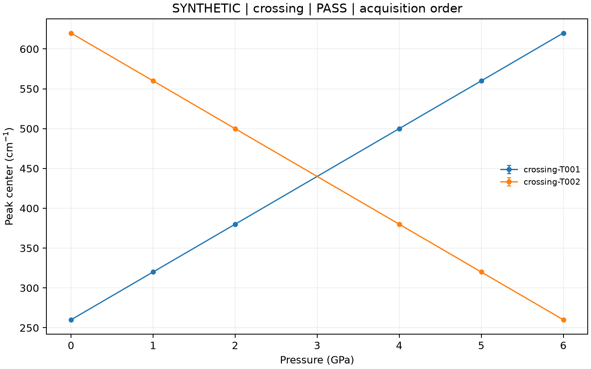

# Raman 光谱分析工具

[](https://github.com/Harihi86/raman-spectroscopy-analysis/actions/workflows/ci.yml)

[English](README.md) · **简体中文** · [详细使用指南](docs/usage.zh-CN.md) · [常见问题](docs/troubleshooting.zh-CN.md)

**当前版本：0.4。** 这是可在本地运行的 Raman 单谱分析、批处理和跨压力峰追踪工具。
它在 SHproject 的基础上保留原始处理源码，建立独立、可配置的新接口。新接口使用用户提供的清单，不导入固定实验名称、压力表或材料窗口。

## 已实现的完整流程

1. 明确指定光谱文件、列名、单位和采集顺序。
2. 对每条光谱独立进行基线估计；可自动提出峰位初值、比较 0–N 个 Gaussian、Lorentzian 或 Voigt 组分，也可手动指定模型。
3. 按独立序列追踪跨压力的峰位，保留重复压力、缺失帧、峰的出现及消失。
4. 将成功、失败、歧义及缺失元数据分别记录。
5. 生成中文/英文离线结果页面、汇总 CSV、逐谱数值结果、追踪图和可核验的 JSON 文件。
6. 保存拟合后，可以只调整追踪参数重新配对，无需重新拟合光谱。

**重要的科学边界：** 轨迹编号表示算法连续性，不直接等于化学或振动模式归属。公开示例均为合成数据。程序不会因优化器返回一个解，就将无法辨识的拟合自动视为可信结果。

## 十分钟内跑通示例

需要 Python 3.11 或更新版本。在本仓库目录安装：

macOS / Linux：

```bash
python3 -m venv .venv
source .venv/bin/activate
python -m pip install .
raman-analyze --lang zh demo-batch --output runs/first-batch
```

Windows PowerShell：

```powershell
py -3.12 -m venv .venv
.venv\Scripts\python.exe -m pip install .
.venv\Scripts\python.exe -m raman_analysis.cli --lang zh demo-batch --output runs/first-batch
```

Windows 可直接调用虚拟环境的 Python，不需要修改系统脚本执行策略。

运行结束后，用浏览器打开生成的 `runs/first-batch/analysis/report.html`。
这个页面可直接查看每条光谱的状态、数据文件、轨迹图和需要复核的事项。

默认示例包含 11 条合成光谱、两个独立压力序列以及重复压力。交叉峰示例：

```bash
raman-analyze --lang zh demo-batch --scenario crossing --output runs/crossing
```



示例的初始峰参数由合成模型明确给出，用于检验分析和追踪流程；它不是自动发现未知峰的性能测试。

## 自动选峰和峰数判断

```bash
raman-analyze --lang zh demo-batch --automatic --scenario crossing --output runs/auto-crossing
raman-analyze --lang zh batch examples/automatic/manifest.json --output runs/auto-example
```

真实数据清单中的拟合配置可以直接写：

```json
{"fit": {"auto": {"shapes": ["gaussian", "lorentzian", "voigt"], "max_peaks": 5, "criterion": "bic", "delta_threshold": 6}}}
```

程序比较零峰与各峰型的不同组分数，按实际参数数量计算 BIC/AICc，保留竞争峰数和跨峰型分歧。默认旧清单仍使用 Gaussian；三峰型比较需要显式设置 `shapes`。达到上限、搜索失败、残差不合适或组分无法辨识时，结果会标为 INCONCLUSIVE。
“最佳候选”是当前基线、窗口和线型下的统计排序，不是已确认的物理峰数。
同一批 184 条实测谱完成 6 组基线复测：163/184 条的总体最佳峰数改变；计入各峰型内部最佳候选后，182/184 条敏感，2/184 条仅在 5 峰上限处数目一致，0 条达到严格支持的稳定标准。诊断阈值未放宽；真实峰数准确率因缺少独立标签而未评估。

[自动选峰完整说明](docs/automatic.zh-CN.md) · [基线、峰型和稳定性指南](docs/profiles-and-baselines.zh-CN.md) · [真实光谱本地验证](docs/real-validation.zh-CN.md)

可直接运行三峰型合成对照：

```bash
raman-analyze --lang zh batch examples/profiles/manifest.json --output runs/profiles
```

新增 arPLS 基线会保存权重迭代的终止原因。对同一批光谱分别运行合理的基线设置后，可用 `stability` 命令比较保存结果；它不在不同校正后的数据之间强行排序 BIC。

## 换成自己的数据

仓库还提供[可直接运行的合成批处理目录](examples/batch)，包含完整清单、CSV 和独立真值。

支持 CSV、TSV、分隔文本 TXT 和 XLSX。有表头时使用列名；无表头时显式设置 `header: null` 并使用列索引。使用 JSON 清单记录：

- `id`：稳定的光谱 ID，使用字母、数字、短横线或下划线，且不重复。
- `label`：可选的显示名称，可以写中文。
- `input`：文件路径、横纵坐标列名、可选测量误差列和 Excel 工作表。
- `pressure_gpa`：可选压力，单位 GPa；缺失时可以省略或写 `null`。
- `series`：独立采集序列。不同样品、压缩/减压分支或需要分开的加热状态应使用不同名称。
- `defaults`：共享分析参数；每条光谱可通过 `analysis` 覆盖。

清单中的顺序就是采集顺序。程序不会自行按压力排序或平均重复压力。
相对输入路径以清单所在目录为基准。

```bash
raman-analyze --lang zh validate manifest.json --check-files
raman-analyze --lang zh batch manifest.json --output runs/my-batch
```

[使用指南](docs/usage.zh-CN.md)提供完整清单、覆盖规则、同一 Excel 多光谱写法和参数解释。
参数示例中的峰位、宽度及追踪阈值都需要根据实际数据选择。

## 结果文件

| 文件 | 用途 |
|---|---|
| `report.html` | 离线总览，带中文/英文说明和逐谱链接 |
| `summary.csv` | 每条光谱的 ID、名称、序列、压力、拟合状态和结果目录 |
| `spectra/<id>/processed.csv` | 读取的原始强度、估计基线及校正后强度 |
| `spectra/<id>/peaks.csv` | 峰位、FWHM、面积和局部误差 |
| `spectra/<id>/fit.csv` | 拟合曲线、所选峰型分量与残差 |
| `spectra/<id>/model-selection.html`、`.json`、`.csv` | 自动模式的峰数比较、竞争模型、拟合初值及诊断 |
| `spectra/<id>/shape-comparison.csv`、`.png`、`.pdf` | 各峰型最佳曲线与残差；图像在开启绘图时输出 |
| `tracking/assignments.csv` | 配对、歧义、排除结果和缺口的完整表 |
| `tracking/tracks.csv` | 每条算法轨迹的摘要 |
| `tracking/series-*.png`、`.pdf` | 各独立序列的压力轨迹图 |
| `batch-report.json` | 完成后的完整机器可读报告 |
| `run.json`、`spectra.jsonl` | 执行状态和已完成记录；中断时保留进度 |
| `manifest.json`、`resolved-spectra.json` | 原始清单及应用覆盖规则后的参数 |
| `artifacts.json` | 输出文件的内容哈希 |

CSV 汇总使用 UTF-8 BOM，方便中文名称在电子表格中显示。
所有输出写入新目录，原输入文件不会被覆盖。

## 如何理解状态

| 状态 | 中文含义 |
|---|---|
| `PASS` | 配置的数值或配对检查通过 |
| `FAIL` | 数值拟合未通过 |
| `INCONCLUSIVE` | 部分结果、拟合诊断或峰身份仍存在未解决问题 |
| `BLOCKED` | 输入文件、列名或配置阻碍分析 |
| `NOT_RUN` | 追踪被明确关闭，或运行尚未完成评估 |

一个文件有问题时，其余文件仍会继续分析。总结果不会把未解决的问题隐藏成成功。
退出码为 0 表示配置流程通过，1 表示已有结果需要复核，2 表示清单或执行条件有误，130 表示用户中断。

## 只重跑峰追踪

把需要调整的追踪参数写成 `tracking.json`：

```json
{
  "prediction": "linear",
  "max_distance_cm1": 20,
  "ambiguity_margin_cm1": 1,
  "max_gap": 1
}
```

```bash
raman-analyze --lang zh track runs/my-batch/batch-report.json --settings tracking.json --output runs/retracked
```

该命令复用保存的拟合结果，不改变原来的拟合或输出。完整参数解释见[使用指南](docs/usage.zh-CN.md)。

## 当前适用范围

手动模式支持 1–8 个正 Gaussian、Lorentzian 或精确 Voigt 峰；自动模式从零峰线性背景到用户配置的最大组分数进行比较，默认上限 5。峰位初值由信号提出，无需手工填入。
单条谱的局部协方差不包含基线估计、校准和模型选择误差。AsLS/arPLS 默认要求近似均匀采样；可显式设置 `resample: true`，只在基线估计时使用均匀网格，拟合仍使用原始采样点。
追踪中的线性预测与代价阈值是可检查的启发式规则，不是经过校准的身份概率。

已对 SHproject 的真实压力光谱开展本地验证，完整记录成功和不确定结果，见[实测验证说明](docs/real-validation.zh-CN.md)。这不等于已经用独立标注证明物理峰数正确。

混合峰型组分、仪器原生格式、自动中断续跑和有独立峰数标注的实验参考验证仍在后续计划中。
它们没有被列为已经完成。历史 SHproject 的完整实验流程仍处于单独的兼容性与科学验证范围。

## 测试与开发

```bash
python -m pip install ".[dev]"
python -m pytest -q
python -m ruff check src tests
python -m ruff format --check src tests
python -m build
```

测试覆盖单谱真值、失败与不可辨识拟合、批处理部分失败、中断记录、交叉峰、重复/缺失压力、独立序列及全局配对的小规模穷举参照。
[验证记录](docs/validation.md)区分本地运行与实际线上 CI 结果。

[更新记录](CHANGELOG.md) · [路线图](ROADMAP.md) · [贡献说明](CONTRIBUTING.md)

软件采用 MIT 许可证；该许可证不授予未公开实验数据或外部文献的使用权。
本项目与 φ³ 理论物理项目独立。φ³ 完整开发工程继续等待 Windows 版本稳定后再整合。
