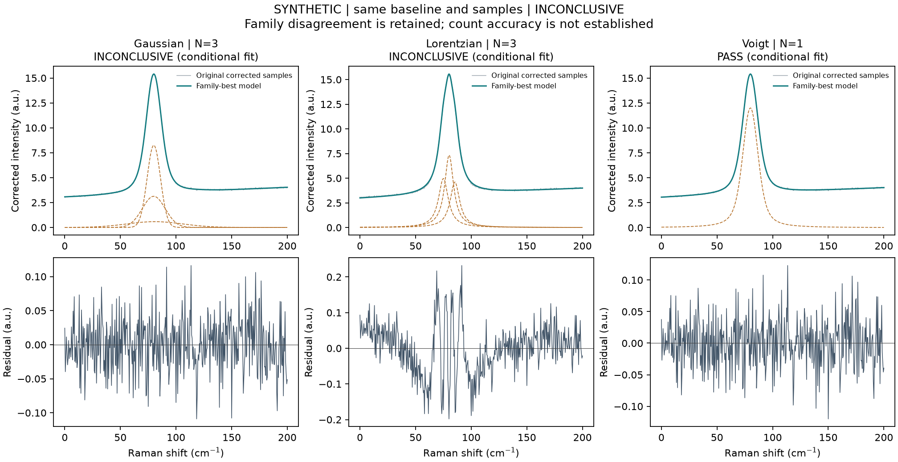

# Peak families, adaptive baselines and count stability

[中文完整说明](profiles-and-baselines.zh-CN.md) · [Automatic criteria](automatic.md)

All profiles use peak height A and center μ. Gaussian has SD σ, Lorentzian has HWHM γ. With t=x−μ:

```
Gaussian(t)   = A exp(-t²/(2σ²))
Lorentzian(t) = A / (1+(t/γ)²)
Voigt(t)      = A V(t;σ,γ)/V(0;σ,γ)
```

V is the unit-area Normal/Cauchy convolution, evaluated using [SciPy voigt_profile](https://docs.scipy.org/doc/scipy/reference/generated/scipy.special.voigt_profile.html). This is an exact Voigt, not a pseudo-Voigt or linear mixture. Each candidate uses one homogeneous family for all components. Mixed-family component searches are outside scope.

Gaussian/Lorentzian FWHM are `2 sqrt(2 ln 2) σ` and `2γ`; Voigt FWHM solves the exact half-height equation with a bracketed root. Full-line areas are `Aσ sqrt(2π)`, `πAγ`, and `A/V(0)`. Local area/FWHM errors propagate the complete within-component covariance, including cross terms. Infinite-line area is not the observed truncated-window integral.

The fitting Jacobian is analytic for all three families. The [Faddeeva derivative identity](https://dlmf.nist.gov/7.10.E2) supplies Voigt derivatives. Near the Cauchy limit, directly subtracting terms in that identity loses digits. For `|t+iγ| > 40σ`, derivatives use seven differentiated terms of the [large-argument expansion](https://dlmf.nist.gov/7.12#i), evaluated with Horner's rule. Profile values continue to use SciPy. Tests compare central differences in both pure-family limits and propagate covariance against independent numerical gradients.

## Configuration

```json
{
  "baseline": {"method": "arpls", "lam": 1000000, "iterations": 100, "tolerance": 0.001, "resample": true},
  "fit": {"auto": {"shapes": ["gaussian", "lorentzian", "voigt"], "max_peaks": 5, "criterion": "bic"}}
}
```

Automatic mode defaults to `shapes:["gaussian"]` for old manifests. Manual mode instead uses `fit.shape` and shape-compatible `peaks`: `sigma`/`sigma_bounds` for Gaussian, `gamma`/`gamma_bounds` for Lorentzian, both for Voigt. Amplitudes and widths must be positive with strictly interior seeds. Sigma and gamma are not interchangeable; unused reported width fields are null.

Automatic `min_sigma_cm1` and `max_sigma_cm1` retain Gaussian-equivalent resolution bounds. Lorentzian gamma bounds map to the same total FWHM range. For Voigt, each convolution width can approach its pure-family limit (positive floor 0.001 times the respective lower width bound), but a total FWHM outside the original resolution range remains INCONCLUSIVE. This avoids mistaking an unresolved narrow component for a supported peak.

All families use identical observations, baseline, errors, count cap and start budget. Mean parameter count is `3N+2` for Gaussian/Lorentzian, `4N+2` for Voigt. Unknown variance adds one noise parameter. The zero-peak linear background is shared once. Diagnostics do not filter converged models out of scoring. Competing counts, incomplete family searches or differing family-best counts remain INCONCLUSIVE. A small score is conditional support, not proof of a physical mode count.

`model-selection.html` shows within-family optima and the full candidate table. JSON preserves every start; `shape-comparison.csv` exports all family-best curves, components and residuals. Component columns/covariance retain input order; peak tables sort centers.

## arPLS baseline

[Baek et al. (2015), DOI 10.1039/C4AN01061B](https://doi.org/10.1039/C4AN01061B) introduces noise-adaptive asymmetric weights. The [pybaselines method reference](https://pybaselines.readthedocs.io/en/latest/algorithms/whittaker.html#arpls-asymmetrically-reweighted-penalized-least-squares) states the weighting equation. This implementation was written independently; pybaselines is not a dependency.

For residual r=y−b and the population mean m and SD s of its negative values:

```
(W + λ D2ᵀ D2) b = W y
w_new = expit(-2 (r - (2s-m))/s)
stop if ||w_new-w||₂ / ||w||₂ < tolerance
```

Defaults are λ=10^6, 100 iterations and tolerance=10^-3. A machine-epsilon weight floor prevents singular arithmetic. An affine trend is subtracted before solving (D2 annihilates it), then restored. Nonconvergence or degenerate negative residual spread is reported; it cannot promote a fit to PASS. AsLS retains its fixed iteration budget and does not assert convergence. Adaptive weighting can still absorb broad/weak peaks or be distorted by negative artifacts; convergence is not a correct-baseline certificate.

Both index-penalty methods require near-uniform axes by default. Explicit `resample:true` estimates the baseline on a same-length uniform grid, maps it back, and leaves fitted observations untouched. Baseline interpolation/estimation uncertainty is not in the local fit covariance. Lambda depends on sampling and background scale.

## Compare saved configurations

```
raman-analyze stability runs/a/batch-report.json runs/b/batch-report.json --output runs/stability
```

Batches must contain identical IDs, provenance and raw samples. Automatic controls, shape sets and fit budgets must agree; only baselines and declared windows may differ. Artifact hashes are checked before comparison. No information criteria are ranked across different baseline-corrected observations.

The stability report includes all variants and each family's best count. `SUPPORTED_STABLE` requires agreement and every model's numerical/count diagnostics to pass; `AGREEMENT_ONLY` retains equal counts with unresolved diagnostics; `SENSITIVE` preserves disagreement; `UNRESOLVED` retains blocked records. A one-family run provides no cross-family evidence. These are sensitivity categories, not calibrated probabilities or independently labelled accuracy.

`tools/check_saved_batch.py` separately checks curve identities, raw-minus-baseline arithmetic, reconstructed family curves, RSS and likelihood penalties from exported samples/errors. Its result explicitly leaves physical count accuracy unassessed.


Generated one-Voigt-peak fixture: a mismatched family may use extra components. This illustrates software behavior, not measured accuracy.


